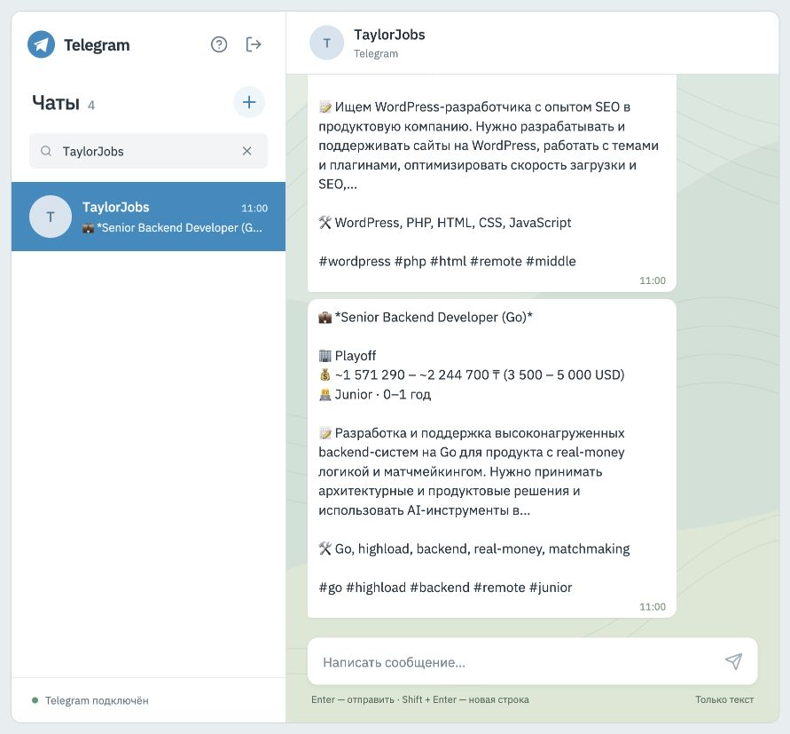
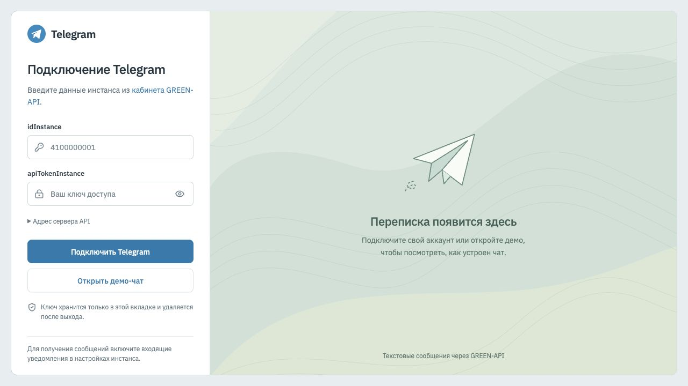
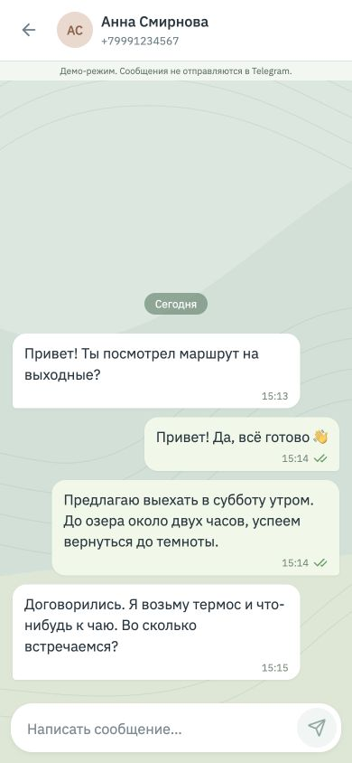
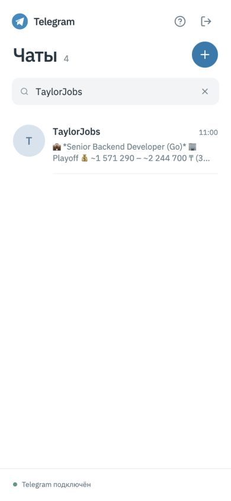
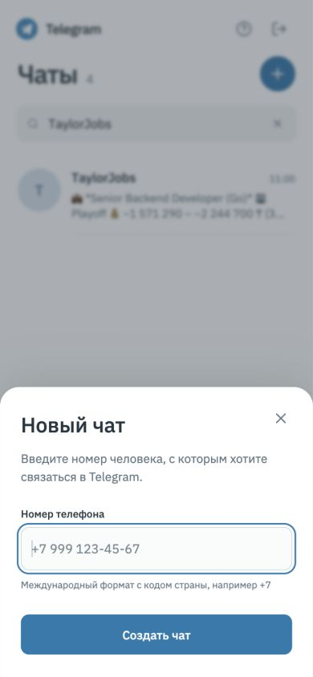

# Telegram Chat — React + GREEN-API

Веб-интерфейс для отправки и получения текстовых сообщений в Telegram через GREEN-API. Тестовое задание на позицию frontend-разработчика React. Адаптивный интерфейс из двух панелей: список чатов и переписка. Локальный шрифт IBM Plex Sans, светлые сообщения и фон с линиями сгибов бумаги.

## Локальный запуск

Понадобятся Node.js **22.12+** и npm.

```bash
npm ci
npm run dev
```

Откройте адрес из терминала, по умолчанию **http://127.0.0.1:5173**. Секреты в `.env` не нужны: данные своего инстанса пользователь вводит на экране входа.

Для знакомства с интерфейсом нажмите **«Открыть демо-чат»**. Демо не обращается к API и отвечает локально. Сообщения в нём не отправляются в мессенджер; режим отмечен отдельной полосой.

## Подключение Telegram (основной режим)

1. В [личном кабинете GREEN-API](https://console.green-api.com/) выберите **Telegram: Developer** и создайте инстанс Telegram.
2. Откройте инстанс, нажмите **«Получить QR»**. На телефоне в Telegram откройте **Настройки → Устройства → Подключить устройство** и отсканируйте QR-код. Дождитесь состояния `authorized`. Подключается обычный аккаунт Telegram, токен BotFather не нужен.
3. В настройках инстанса включите **«Получать уведомления о входящих сообщениях и файлах»** (`incomingWebhook: "yes"`). **Webhook URL оставьте пустым**. Для статусов доставки включите `outgoingWebhook: "yes"`.
4. На экране входа приложения введите `idInstance`, `apiTokenInstance`. В разделе **«Адрес сервера API»** укажите `apiUrl` из кабинета. Значение по умолчанию — предположение по первым четырём цифрам idInstance, его нужно сверить.
5. Нажмите **«Подключить Telegram»**, создайте чат по международному номеру (включая +7 для Казахстана) и отправьте текст. Получатель должен ответить со своего аккаунта Telegram.

Поиск номера зависит от настроек приватности получателя: если аккаунт не найден, проверьте номер и доступность поиска по телефону. Для отправки используется `chatId`, полученный методом CheckAccount.

Документация: [подключение Telegram](https://green-api.com/telegram/docs/before-start/), [CheckAccount](https://green-api.com/telegram/docs/api/service/CheckAccount/), [SendMessage](https://green-api.com/telegram/docs/api/sending/SendMessage/), [HTTP API](https://green-api.com/telegram/docs/api/receiving/technology-http-api/).

Одному инстансу нужен один активный потребитель очереди. Закройте другие вкладки с этим инстансом и другие программы, которые вызывают ReceiveNotification: иначе они могут забрать ответы раньше этого приложения.

## Возможности и ограничения

- Вход с проверкой состояния инстанса и настроек приёма уведомлений.
- Создание личного чата по номеру телефона; несколько переписок, поиск по имени/номеру, непрочитанные сообщения и черновик для каждого чата.
- Отправка только текста, включая переносы строк и emoji, до 4000 символов.
- Получение текста и текста со ссылкой через HTTP API. Другие типы уведомлений подтверждаются и пропускаются; прикреплённые файлы не отображаются.
- Автоматическое создание чата при входящем тексте от нового собеседника.
- Статусы очереди, доставки, прочтения и ошибки. Одна галочка означает принятие GREEN-API в очередь, а не доставку адресату.
- Восстановление опроса с задержкой после временных сбоев; ручное переподключение после ошибок доступа/настроек.
- Повторная отправка неудачного сообщения. При таймауте сначала проверьте мессенджер: сервер мог принять запрос, хотя браузер не получил ответ. Автоматического повторения отправки нет.
- На телефоне список и переписка отображаются отдельно. Крупные зоны нажатия, превью в две строки, создание чата через нижнюю панель. Поле ввода учитывает уменьшение visual viewport и safe-area.
- Токен, переписки и черновики находятся **только в памяти вкладки**. При выходе или перезагрузке они очищаются. Уже подтверждённые уведомления из очереди не восстанавливаются; загрузка прошлой истории не входит в задание.

Приложение — клиент для тестового задания, не официальный веб-клиент Telegram. Данные доступа отправляются напрямую на HTTPS API GREEN-API, без собственного backend. Разрешены только хосты GREEN-API. Токен не записывается в localStorage, sessionStorage, cookies или логи приложения. Браузерная панель Network всё равно показывает запросы с ключом, как и для любого прямого клиента этого API.

## Проверка

```bash
npm test
npm run build
npm run preview
```

Тесты проверяют контракт API (адреса, методы и тела запросов), обработку ошибок, отмену запросов, последовательность Receive → обработка → Delete, задержку повторного опроса, дедупликацию уведомлений, статусы, пришедшие до завершения отправки, и пользовательский сценарий вход → новый чат → отправка → ответ → повтор после ошибки → выход. Для тестов используется подменённый `fetch`, реальные сообщения не отправляются.

Проверка с реальным инстансом требует собственных данных GREEN-API. Без них успешная доставка в реальный мессенджер не подтверждена.

## Архитектура

```text
src/
  api/greenApi.ts              HTTP-клиент, валидация и понятные ошибки
  api/polling.ts               Последовательный опрос, ACK, отмена и backoff
  chatState.ts                Reducer чатов и сообщений, дедупликация
  components/Login.tsx        Ввод данных и проверка подключения
  components/ChatWorkspace.tsx Переписки, отправка, приём, демо
  components/NewChatDialog.tsx Создание чата по номеру
  types/                      Контракты API, модели чатов и сессия
  styles/                     Токены, базовые стили, элементы управления, каркас
  components/*.css            Стили компонентов с адаптивными правилами
  components/*.types.ts       Типы пропсов компонентов
```

Стек: **React 19, TypeScript, Vite, Lucide**, тесты **Vitest + Testing Library**. Глобальная библиотека состояния не нужна: состояние одной сессии хранится в reducer, запросы вынесены из представления.

Опрос работает одним асинхронным циклом с `receiveTimeout=20`. Уведомление подтверждается `DeleteNotification` после обработки. Если подтверждение не удалось, сервер может выдать уведомление повторно: reducer не добавляет дубликат по `idMessage`. Ошибки 400/401/403 останавливают цикл, временные сбои повторяются с задержкой от 1 до 20 секунд. Выход отменяет запросы и таймеры через AbortController.

## Публикация

`npm run build` создаёт статический сайт в папке **dist**. Для статического хостинга задайте:

| Параметр | Значение |
| --- | --- |
| Команда установки | `npm ci` |
| Команда сборки | `npm run build` |
| Каталог публикации | `dist` |
| Версия Node.js | `22.12+` |

В проекте нет роутера и серверной части. Используйте HTTPS. При размещении в подпапке измените `base` в конфигурации Vite и пути к статическим SVG; текущая конфигурация рассчитана на корень домена. `vite preview` подходит для локальной проверки сборки.

Перед отправкой работодателю загрузите исходники в свой GitHub-репозиторий. Ссылка на этот README будет инструкцией запуска. Шаблон сопроводительного письма находится в [docs/submission.txt](docs/submission.txt); замените все поля в квадратных скобках своими данными.

## Скриншоты

Скриншоты показывают демо-режим, без реальных данных доступа.











## Документация API

- [SendMessage](https://green-api.com/telegram/docs/api/sending/SendMessage/)
- [Получение уведомлений через HTTP API](https://green-api.com/telegram/docs/api/receiving/technology-http-api/)
- [ReceiveNotification](https://green-api.com/telegram/docs/api/receiving/technology-http-api/ReceiveNotification/)
- [DeleteNotification](https://green-api.com/telegram/docs/api/receiving/technology-http-api/DeleteNotification/)
- [CheckAccount](https://green-api.com/telegram/docs/api/service/CheckAccount/)
