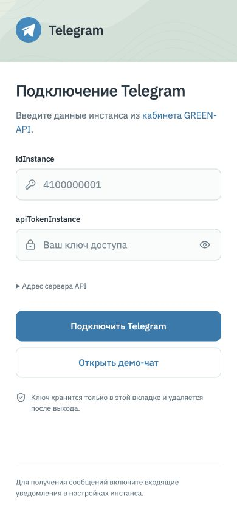

# Telegram Chat

Чат на **React и TypeScript** для отправки и получения текстовых сообщений в Telegram через **GREEN-API**. Проект выполнен как тестовое задание на позицию frontend-разработчика.

Приложение подключает аккаунт Telegram, показывает входящие сообщения и позволяет вести несколько переписок. Интерфейс адаптирован для компьютера и телефона. Для просмотра без аккаунта есть демо-режим.

## Почему Telegram, а не MAX

На момент выполнения задания **MAX не был доступен в использованном личном кабинете GREEN-API**: для создания инстанса предлагались Telegram и WhatsApp. Поэтому для реализации и проверки был выбран Telegram.

Поддержка MAX в проект не включена, поскольку проверить её с реальным инстансом не удалось. Все запросы и сценарии подключения реализованы для Telegram.

## Быстрый запуск через Docker

Проверяющему достаточно **Docker Desktop с Docker Compose**. Устанавливать Node.js и npm на компьютер не нужно.

Из корня проекта выполните:

```bash
docker compose up --build -d
```

Откройте [http://localhost:8080](http://localhost:8080/). Для просмотра интерфейса без аккаунта нажмите **«Открыть демо-чат»**; для реального обмена сообщениями подключите свой инстанс по инструкции ниже.

Первая сборка скачает образы и зависимости — потребуется интернет. Повторный запуск использует кеш. Приложение собирается в Node.js, а готовые файлы обслуживает Nginx. API GREEN-API вызывается из браузера, поэтому для реального подключения также нужен интернет.

| Действие | Команда |
| --- | --- |
| Запустить или пересобрать после изменения кода | `docker compose up --build -d` |
| Посмотреть состояние | `docker compose ps` |
| Посмотреть логи | `docker compose logs -f web` |
| Остановить и удалить контейнер | `docker compose down` |
| Запустить тесты в отдельном контейнере | `docker compose --profile checks run --build --rm tests` |

Если порт 8080 занят, задайте другой порт в строке `ports` файла `compose.yaml`, например `127.0.0.1:8081:8080`, и откройте `http://localhost:8081`.

Контейнер доступен только с компьютера проверяющего. Ключи GREEN-API вводятся в браузере и не включаются в образ.

Конфигурация: `Dockerfile` задаёт этапы сборки, тестирования и запуска; `compose.yaml` — сервис приложения и необязательный сервис тестов; `docker/nginx.conf` — раздачу готовых файлов; `.dockerignore` — минимальный состав контекста сборки.

## Запуск без Docker

Нужны **Node.js 22.12+** и **npm**.

```bash
npm ci
npm run dev
```

Откройте [http://127.0.0.1:5173](http://127.0.0.1:5173/) или адрес, который выведет Vite в терминале.

**Чтобы просто посмотреть интерфейс**, нажмите «Открыть демо-чат». Данные GREEN-API не понадобятся: сообщения и ответы работают локально и никуда не отправляются.

**Чтобы подключить свой Telegram**, выполните шаги ниже. Файл `.env` не нужен — данные инстанса вводятся в форме приложения.

## Подключение своего аккаунта

1. В [личном кабинете GREEN-API](https://console.green-api.com/) создайте инстанс **Telegram: Developer**.
2. Подключите аккаунт через QR-код: в Telegram на телефоне откройте **Настройки → Устройства → Подключить устройство**. Дождитесь статуса `authorized` в кабинете GREEN-API. Токен BotFather не нужен.
3. В настройках инстанса включите **«Получать уведомления о входящих сообщениях и файлах»** и сохраните изменения. **Адрес отправки уведомлений (Webhook URL) оставьте пустым** — приложение получает сообщения через HTTP-очередь. Для статусов доставки также включите уведомления о статусах отправленных сообщений.
4. Скопируйте из кабинета данные в форму приложения:

   | Поле | Что указать |
   | --- | --- |
   | `idInstance` | Идентификатор инстанса |
   | `apiTokenInstance` | Токен доступа к этому инстансу |
   | Адрес сервера API | Значение `apiUrl` из кабинета |

   Адрес API находится в раскрываемом разделе формы. Автоматически предложенное значение нужно сверить с кабинетом.

5. Нажмите **«Подключить Telegram»**. Затем нажмите **«Новый чат»**, введите номер получателя в международном формате и отправьте текст.

Приложение использует `CheckAccount`, чтобы получить `chatId` по номеру телефона. Поиск может зависеть от настроек приватности получателя.

## Что реализовано

| Возможность | Как работает |
| --- | --- |
| Подключение | Проверка авторизации и настроек инстанса |
| Переписки | Несколько чатов, поиск, непрочитанные сообщения и отдельные черновики |
| Новый чат | По международному номеру телефона |
| Отправка | Текст, переносы строк и emoji — до 4000 символов |
| Приём | Входящие текстовые сообщения через HTTP API; новый чат создаётся автоматически |
| Статусы | Принято в очередь, доставлено, прочитано и ошибка — при включённых уведомлениях |
| Ошибки | Понятные сообщения, восстановление опроса после временного сбоя и ручная повторная отправка |
| Мобильная версия | Отдельные экраны списка и переписки, нижняя панель создания чата, поле ввода с учётом высоты видимой области |
| Демо | Просмотр и локальный обмен сообщениями без подключения к API |

## Скриншоты

Переписка и список чатов сняты в приложении с реальным подключением Telegram. На скриншотах показан чат **TaylorJobs**, выбранный с согласия владельца аккаунта; другие переписки скрыты поиском. Экраны входа сняты без данных доступа. Мобильные кадры получены при размере окна **390 × 844 px**.

### Компьютер


### Телефон

| Список чатов | Переписка |
| --- | --- |
|  |  |

<details>
<summary>Экран подключения и создание чата</summary>


| Подключение на телефоне | Новый чат |
| --- | --- |
|  |  |

</details>

## Ограничения

- **Только текст.** Отправка файлов, голосовых сообщений и других вложений не реализована. Уведомления неподдерживаемых типов подтверждаются и пропускаются.
- **Без загрузки старой истории.** Приложение показывает сообщения, полученные из очереди во время работы. Это не полная история аккаунта Telegram.
- **Данные хранятся в памяти вкладки.** После перезагрузки или выхода токен, чаты и черновики очищаются. Уже подтверждённые уведомления повторно не загружаются.
- **Одна активная вкладка на инстанс.** Другие приложения или вкладки, читающие ту же очередь `ReceiveNotification`, могут получить сообщения раньше этого клиента.
- **Одна галочка означает принятие в очередь GREEN-API.** Доставка и прочтение зависят от уведомлений сервиса.
- **После таймаута отправки проверьте Telegram перед повтором.** Сервер мог принять сообщение, даже если браузер не получил ответ. Автоматического повторения отправки нет.

Запросы идут напрямую из браузера на HTTPS API GREEN-API. Собственного backend нет. Токен не сохраняется в `localStorage`, `sessionStorage`, cookies или логах приложения; он присутствует в сетевых запросах API, видимых в инструментах разработчика браузера.

## Стек и структура

**React 19 · TypeScript · Vite · CSS · Lucide**

Тесты: **Vitest · Testing Library · axe-core**. Шрифт IBM Plex Sans поставляется локально через `@fontsource`.

```text
src/
├── api/
│   ├── greenApi.ts
│   └── polling.ts
├── components/
│   ├── Login.tsx
│   ├── ChatWorkspace.tsx
│   ├── NewChatDialog.tsx
│   ├── Brand.tsx
│   ├── *.css
│   └── *.types.ts
├── types/
│   ├── api.ts
│   ├── chat.ts
│   └── session.ts
├── styles/
├── chatState.ts
├── useMobileViewportHeight.ts
├── App.tsx
└── main.tsx
```

Состояние сессии хранится в React, чаты и сообщения управляются reducer. HTTP-запросы отделены от компонентов интерфейса.

Приём работает последовательно: **ReceiveNotification → обработка → DeleteNotification**. Повторное уведомление не создаёт дубликат сообщения. Временные ошибки повторяются с задержкой от 1 до 20 секунд; ошибки 400/401/403 останавливают опрос. При выходе запросы и таймеры отменяются.

## Проверка проекта

```bash
npm test
npm run build
npm run preview
```

Автоматические тесты проверяют:

- методы, адреса и тела API-запросов, ошибки и отмену;
- последовательный опрос очереди и повтор после временных сбоев;
- дедупликацию и обновление статусов сообщений;
- сценарий входа, создания чата, отправки, получения ответа, повторной отправки и выхода;
- правило доступности `aria-prohibited-attr` и обновление высоты мобильного экрана.

Тесты используют подменённый `fetch` и не отправляют реальные сообщения. Отдельно приложение было подключено к реальному аккаунту Telegram: получение входящих сообщений проверено пользователем. Это не заменяет автоматические тесты и не подтверждает все сценарии доставки.

В Docker те же тесты можно выполнить командой `docker compose --profile checks run --build --rm tests`.

## Сборка и размещение

После `npm run build` готовые файлы находятся в **`dist/`**. Их можно разместить на статическом хостинге.

| Параметр хостинга | Значение |
| --- | --- |
| Установка зависимостей | `npm ci` |
| Команда сборки | `npm run build` |
| Каталог публикации | `dist` |
| Node.js | `22.12+` |

Текущая конфигурация рассчитана на корень домена. Для подпапки потребуется изменить `base` в Vite и пути к SVG. `npm run preview` предназначен для локального просмотра сборки.

## Документация GREEN-API

- [Подключение Telegram](https://green-api.com/telegram/docs/before-start/)
- [CheckAccount — поиск аккаунта по номеру](https://green-api.com/telegram/docs/api/service/CheckAccount/)
- [SendMessage — отправка текста](https://green-api.com/telegram/docs/api/sending/SendMessage/)
- [Получение уведомлений через HTTP API](https://green-api.com/telegram/docs/api/receiving/technology-http-api/)
- [ReceiveNotification](https://green-api.com/telegram/docs/api/receiving/technology-http-api/ReceiveNotification/)
- [DeleteNotification](https://green-api.com/telegram/docs/api/receiving/technology-http-api/DeleteNotification/)
